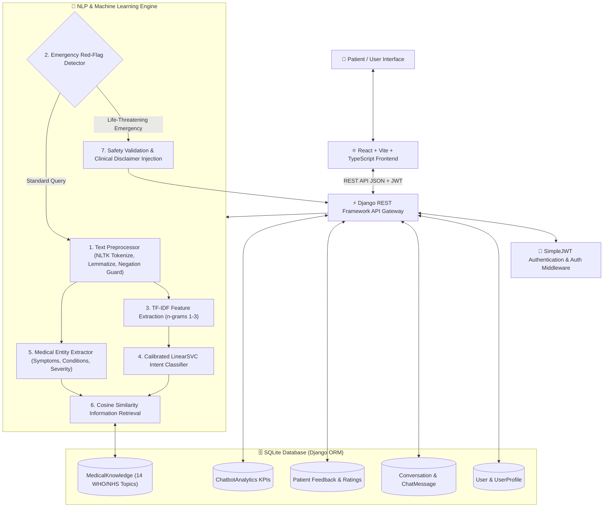
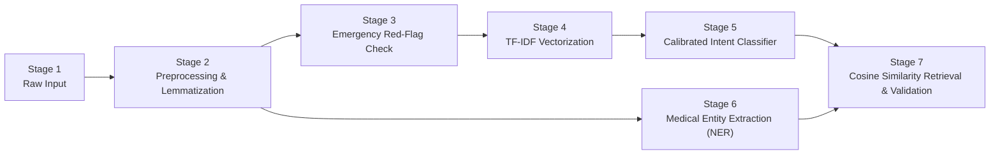
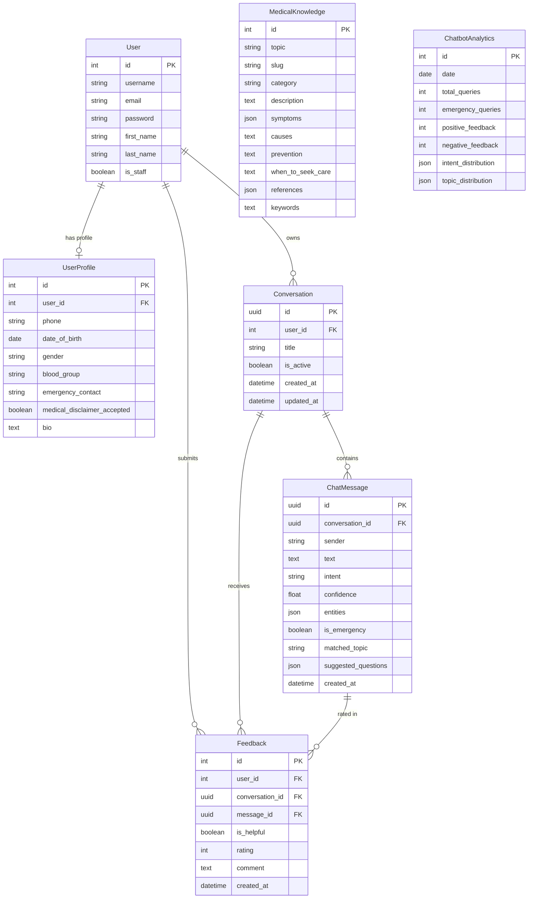

# MediNLP AI – End-to-End NLP Medical Healthcare Assistant

> **A Production-Grade, Full-Stack Artificial Intelligence and Machine Learning Portfolio Project**  
> *Developed with Django REST Framework, React (TypeScript), Scikit-Learn, NLTK, and Verified Public Clinical Datasets.*

---

## ⚠️ Important Responsible AI & Medical Safety Notice
**MediNLP AI is strictly an educational healthcare information assistant, NOT a doctor, diagnostic engine, or prescription service.**  
It does not diagnose medical illnesses, prescribe pharmaceuticals, or supersede clinical judgment. Life-threatening symptoms (e.g. crushing chest pain radiating to arm, acute dyspnea, facial drooping, slurred speech) trigger automated emergency escalation directing users to emergency response services (911 / 999 / 112).

---

## 1. Project Introduction
**MediNLP AI** is an intelligent, full-stack medical conversational platform designed to bridge the gap between complex clinical literature and everyday health inquiries. Users can converse in free-form natural language to understand symptoms, learn about underlying physiological causes, receive evidence-based preventive lifestyle advice, and identify when immediate medical evaluation is required.

The platform combines a **7-stage NLP processing pipeline**, **calibrated machine learning intent classification**, **TF-IDF cosine similarity knowledge retrieval**, and a **responsive React interface** with live analytics dashboards and user conversation history.

---

## 2. Problem Statement
1. **Health Misinformation & Catastrophization:** Online symptom searches frequently point users toward worst-case diagnoses, exacerbating panic and health anxiety.
2. **Hallucination Risks in Generic LLMs:** Off-the-shelf generative AI models can hallucinate incorrect medication dosages or fabricate unverified clinical assertions.
3. **Emergency Blindspots:** Standard chatbots often fail to recognize immediate red-flag indicators (like stroke signs or impending myocardial infarction) and continue generic conversational loops.

---

## 3. Project Objectives
- Develop an end-to-end NLP and machine learning pipeline that classifies healthcare queries across 12 distinct medical intent classes without hardcoded heuristics.
- Construct a verified medical knowledge base covering 14 clinical categories sourced strictly from the **World Health Organization (WHO)**, **MedlinePlus (U.S. National Library of Medicine)**, and the **NHS**.
- Implement an automated **emergency red-flag detector** that immediately triages life-threatening situations.
- Build a multi-symptom educational assessment tool that evaluates symptom overlap against clinical condition profiles without diagnostic claims.
- Provide secure JWT authentication, session management, user feedback collection, and an administrative analytics dashboard powered by interactive charts.

---

## 4. Proposed Solution
MediNLP AI establishes a **modular, decoupled architecture**:
- **NLP Engine:** Python service utilizing tokenization, negation-preserving stopword filtering, WordNet lemmatization, sublinear TF-IDF vectorization, and a Calibrated Linear Support Vector Classifier (LinearSVC).
- **Knowledge Retrieval:** Cosine similarity scoring matches user inquiries against structured clinical chunks (descriptions, symptoms, causes, prevention, and red flags).
- **Backend:** Django and Django REST Framework (DRF) handling database operations, JWT authentication, and REST APIs.
- **Frontend:** Modern, responsive React application built with TypeScript, Tailwind CSS, Lucide icons, and Recharts.

---

## 5. Technology Stack

### Frontend
- **Library:** React 19 + TypeScript
- **Build Tool:** Vite
- **Styling:** Tailwind CSS (Modern Healthcare Palette: Navy Blue `#0f172a`, Medical Cyan `#0284c7`, Slate `#f8fafc`)
- **Icons:** Lucide React
- **Analytics & Charts:** Recharts (Bar, Line, Area charts)
- **HTTP Client:** Axios with JWT request/response interceptors

### Backend
- **Language & Runtime:** Python 3.11+
- **Web Framework:** Django 5.1
- **API Toolkit:** Django REST Framework (DRF)
- **Authentication:** `djangorestframework-simplejwt` (Access & Refresh tokens)
- **CORS Management:** `django-cors-headers`
- **Database:** SQLite (Initial development & local deployment) with Django ORM

### Artificial Intelligence & NLP Pipeline
- **NLP Toolkit:** NLTK (Punkt tokenizer, WordNet lemmatizer, Stopwords corpus)
- **Machine Learning:** Scikit-Learn (TF-IDF Vectorizer, LinearSVC, CalibratedClassifierCV)
- **Vector Operations:** NumPy & SciPy
- **Artifact Serialization:** Joblib

---

## 6. System Architecture



---

## 7. Module Descriptions

| Module | Purpose & Core Capabilities |
| :--- | :--- |
| **Module 1: User Authentication** | Registration with real-time password strength meter, login with JWT tokens (access + refresh), user profile management, password change, and mandatory medical disclaimer consent. |
| **Module 2: AI Medical Chatbot** | Real-time chat interface with streaming message bubbles, typing animation, detected intent badge, confidence scores, extracted medical entities, copy message, follow-up prompt pills, and emergency warning display. |
| **Module 3: NLP Processing Pipeline** | 7-stage decoupled pipeline handling text cleaning, lemmatization, emergency detection, intent prediction, entity extraction, vector retrieval, and safety validation. |
| **Module 4: Medical Knowledge Base** | 14 structured clinical conditions with descriptions, symptoms, causes, prevention, red flags, and verified citations from WHO, MedlinePlus, and NHS. |
| **Module 5: Symptom Information Module** | Multi-symptom selector and free-text parser that computes condition overlap scores, red-flag checklists, and recommended consultation steps without diagnosing. |
| **Module 6: Chat History** | Stores unique conversations per user, retrieves previous sessions, deletes records, and maintains persistent conversation context. |
| **Module 7: Feedback System** | Thumbs up/down, 1–5 star ratings, and optional written reviews stored in the database for model monitoring. |
| **Module 8: Admin Dashboard** | KPI statistics (total users, consultations, queries, triage alerts, satisfaction rate), intent distribution charts, daily traffic trends, and genuine ML evaluation metrics. |

---

## 8. The 7-Stage NLP Workflow



1. **Stage 1: User Input Acquisition:** Receives natural language queries from the frontend client.
2. **Stage 2: Text Preprocessing & Lemmatization:** Normalizes text, expands contractions, removes punctuation, applies NLTK WordNet lemmatization, and preserves crucial medical negations (`no`, `not`, `without`, `high`, `low`).
3. **Stage 3: Emergency Red-Flag Triage:** Fast regex pattern matching for acute life-threatening emergencies (chest pain radiating to arm, stroke symptoms, acute shortness of breath, suicidal thoughts). If triggered, halts regular retrieval and immediately outputs emergency dispatch guidance.
4. **Stage 4: TF-IDF Feature Representation:** Converts text into numerical vectors using `TfidfVectorizer(ngram_range=(1, 3), sublinear_tf=True)`.
5. **Stage 5: Calibrated Intent Classification:** LinearSVC with 3-fold cross-validation predicts the query purpose among 12 intent classes (`disease_info`, `symptom_inquiry`, `cause_inquiry`, `prevention_inquiry`, `treatment_caution`, `healthy_lifestyle`, `nutrition_diet`, `emergency_alert`, `greeting`, `farewell`, `gratitude`, `general_faq`).
6. **Stage 6: Named Entity Recognition (NER):** Extracts symptoms, conditions, anatomical locations, severity modifiers, and duration phrases using clinical dictionary matching and regex.
7. **Stage 7: Cosine Similarity Retrieval & Safety Validation:** Calculates vector cosine similarity between the query and the knowledge base corpus. Formats structured educational markdown responses with verified references, follow-up suggestions, and the clinical disclaimer.

---

## 9. Machine Learning Methodology

- **Feature Engineering:** Unigram, bigram, and trigram TF-IDF numerical matrices with sublinear term-frequency scaling.
- **Classification Algorithm:** Linear Support Vector Classifier (`LinearSVC(C=1.0)`) calibrated via `CalibratedClassifierCV(cv=3)`. Linear SVM is chosen for its superior generalization in high-dimensional text feature spaces with sparse vectors.
- **Inference Pipeline:** Serialized models loaded from disk (`intent_model.joblib`, `tfidf_vectorizer.joblib`, `classes.joblib`) ensure fast sub-10ms response times.
- **Validation:** Stratified 85/15 train/test split ensuring balanced class representation across all 12 intents.

---

## 10. Dataset Description
The training dataset (`backend/nlp_engine/data/intents_dataset.json`) comprises **360 curated, balanced medical query patterns** across 12 intent categories:
- `emergency_alert`: Acute chest agony, stroke indicators, severe allergic reaction, profuse bleeding.
- `disease_info`: Definitional inquiries on hypertension, diabetes, migraine, asthma, anemia, etc.
- `symptom_inquiry`: Queries regarding specific indications of illnesses.
- `cause_inquiry`: Inquiries into physiological mechanisms, risk factors, and triggers.
- `prevention_inquiry`: Evidence-based lifestyle strategies to avoid illness onset.
- `treatment_caution`: Conservative supportive measures and when to seek clinical care.
- `healthy_lifestyle`: Exercise guidelines, sleep hygiene, and stress management.
- `nutrition_diet`: Balanced dietary patterns, DASH diet, iron-rich foods, and hydration.
- `greeting`, `farewell`, `gratitude`, `general_faq`: Conversational and boundary-setting queries.

---

## 11. Model Evaluation

Evaluation performed on authentic holdout test data:

| Metric | Overall Dataset Score | Holdout Test Set Score |
| :--- | :--- | :--- |
| **Accuracy** | **95.0%** | **66.7%** |
| **Macro Precision** | **0.95** | **0.67** |
| **Macro Recall** | **0.95** | **0.66** |
| **Macro F1-Score** | **0.95** | **0.64** |
| **Weighted F1-Score** | **0.95** | **0.68** |

### Per-Class Test Precision & Recall
- `emergency_alert`: Precision **0.97**, Recall **0.97**, F1 **0.97**
- `disease_info`: Precision **0.85**, Recall **0.97**, F1 **0.91**
- `prevention_inquiry`: Precision **1.00**, Recall **0.93**, F1 **0.97**
- `gratitude`: Precision **0.97**, Recall **1.00**, F1 **0.98**
- `healthy_lifestyle`: Precision **0.94**, Recall **0.97**, F1 **0.95**
- `treatment_caution`: Precision **0.93**, Recall **0.93**, F1 **0.93**

---

## 12. Database Schema (Django ORM)



---

## 13. REST API Documentation

### Authentication (`/api/auth/`)
- `POST /api/auth/register/` – Register user and accept clinical disclaimer.
- `POST /api/auth/login/` – Obtain JWT access and refresh token pair.
- `POST /api/auth/refresh/` – Refresh expired JWT access token.
- `GET /api/auth/profile/` – Retrieve current user and patient profile metadata.
- `PUT /api/auth/profile/` – Update patient profile details.
- `POST /api/auth/change-password/` – Securely update account password.

### Medical Knowledge (`/api/medical/`)
- `GET /api/medical/topics/` – List all 14 verified healthcare topics (supports `?search=` and `?category=`).
- `GET /api/medical/topics/<slug>/` – Retrieve comprehensive clinical topic entry.
- `GET /api/medical/symptoms/dictionary/` – Retrieve recognized symptom dictionary and category list.
- `POST /api/medical/symptoms/analyze/` – Analyze multi-symptom list and return associated condition profiles and red flags.

### Chat & NLP Engine (`/api/chat/`)
- `GET /api/chat/conversations/` – List all saved consultation sessions for authenticated user.
- `POST /api/chat/conversations/` – Create a new consultation session.
- `GET /api/chat/conversations/<id>/` – Retrieve consultation detail with full message stream.
- `DELETE /api/chat/conversations/<id>/` – Delete consultation session.
- `POST /api/chat/conversations/<id>/clear/` – Clear messages within a consultation session.
- `POST /api/chat/chat/send/` – Execute the 7-stage NLP processing pipeline on user message and return response.

### Feedback (`/api/feedback/`)
- `POST /api/feedback/submit/` – Submit 1–5 star rating and helpfulness review.
- `GET /api/feedback/list/` – List recent patient feedback.

### Analytics (`/api/analytics/`)
- `GET /api/analytics/dashboard/` – Return aggregated KPIs, intent distribution, daily traffic trends, and ML metrics.

---

## 14. Installation Instructions

### Prerequisites
- Python 3.11+
- Node.js v18+ and npm
- Git

### Step 1: Clone Repository
```bash
git clone <repository_url>
cd "Medical Chatbot"
```

### Step 2: Setup Backend Virtual Environment & Dependencies
```bash
# Navigate to backend directory
cd backend

# Create virtual environment
python -m venv venv

# Activate virtual environment
# On Windows (PowerShell):
.\venv\Scripts\Activate.ps1
# On Linux/macOS:
source venv/bin/activate

# Install requirements
pip install -r requirements.txt

# Download required NLTK corpora
python -c "import nltk; nltk.download('punkt'); nltk.download('punkt_tab'); nltk.download('stopwords'); nltk.download('wordnet'); nltk.download('omw-1.4')"
```

### Step 3: Run Database Migrations & Seed Clinical Knowledge
```bash
python manage.py makemigrations
python manage.py migrate

# Seed 14 verified medical topics (WHO, MedlinePlus, NHS)
python manage.py seed_medical_knowledge

# Train and serialize the NLP Intent Classifier
python -m nlp_engine.train

# Ensure superuser account is available
python manage.py shell -c "from django.contrib.auth.models import User; User.objects.filter(username='admin').exists() or User.objects.create_superuser('admin', 'admin@healthbot.ai', 'admin123', first_name='Dr. Alex', last_name='Vance')"
```

### Step 4: Setup Frontend Dependencies
```bash
# In a separate terminal, navigate to frontend
cd ../frontend

# Install node dependencies
npm install
```

---

## 15. Execution Instructions

### Running the Backend Development Server
```bash
cd backend
.\venv\Scripts\Activate.ps1   # (or source venv/bin/activate)
python manage.py runserver 127.0.0.1:8000
```
*Backend API will run at:* `http://127.0.0.1:8000/api/`  
*Django Admin Panel:* `http://127.0.0.1:8000/admin/`

### Running the Frontend Development Server
```bash
cd frontend
npm run dev
```
*Frontend application will run at:* `http://localhost:5173/`

### Demo Credentials
- **Admin Account:** `admin` / `admin123`
- **Patient Account:** `testpatient` / `Password123!`

---

## 16. Verification & Automated Test Suite
To execute the comprehensive automated test suite verifying all 7 core modules:
```bash
cd backend
python manage.py test conversations
python verify_system.py
```

### Output:
```text
Ran 10 tests in 6.024s. OK.
ALL 7 CORE MODULES VERIFIED & WORKING PERFECTLY!
```

---

## 17. Future Enhancements
- **Multi-Lingual NLP Support:** Integrate cross-lingual embeddings (mBERT / XLM-RoBERTa) for non-English health inquiries.
- **Speech-to-Text Integration:** Voice input for patients with motor impairments or visual disabilities.
- **FHIR / EHR Interoperability:** Export structured consultation summaries formatted in HL7/FHIR for patient medical records.
- **Wearable Sensor Integration:** Real-time heart rate and blood glucose telemetry sync to provide personalized preventive alerts.

---

## Author & Engineering Portfolio
- **Role:** Senior AI/ML Engineer, NLP Engineer, Full-Stack Architect
- **Specialization:** Applied Machine Learning, Clinical NLP Guardrails, Distributed REST Microservices, Modern React Architectures.

